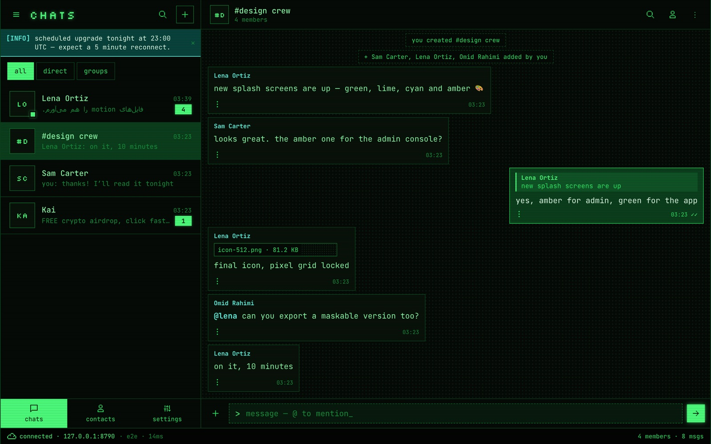
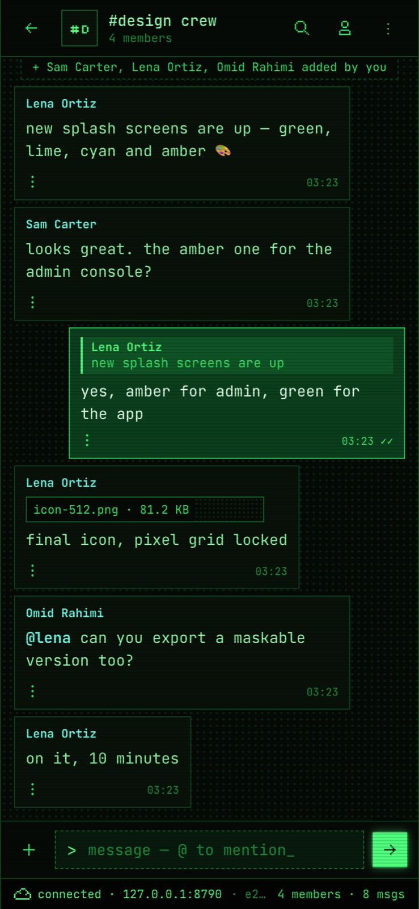
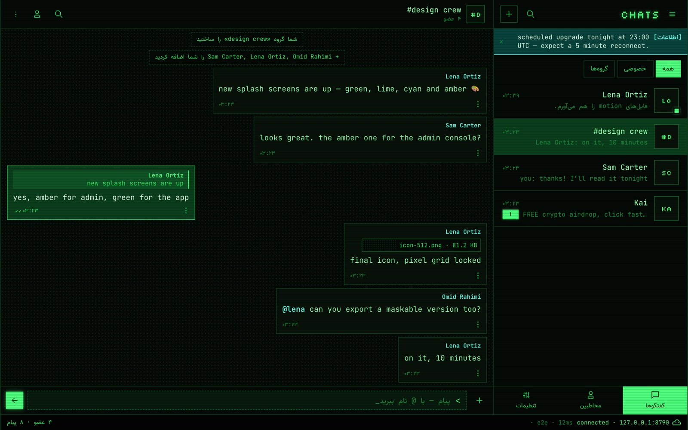
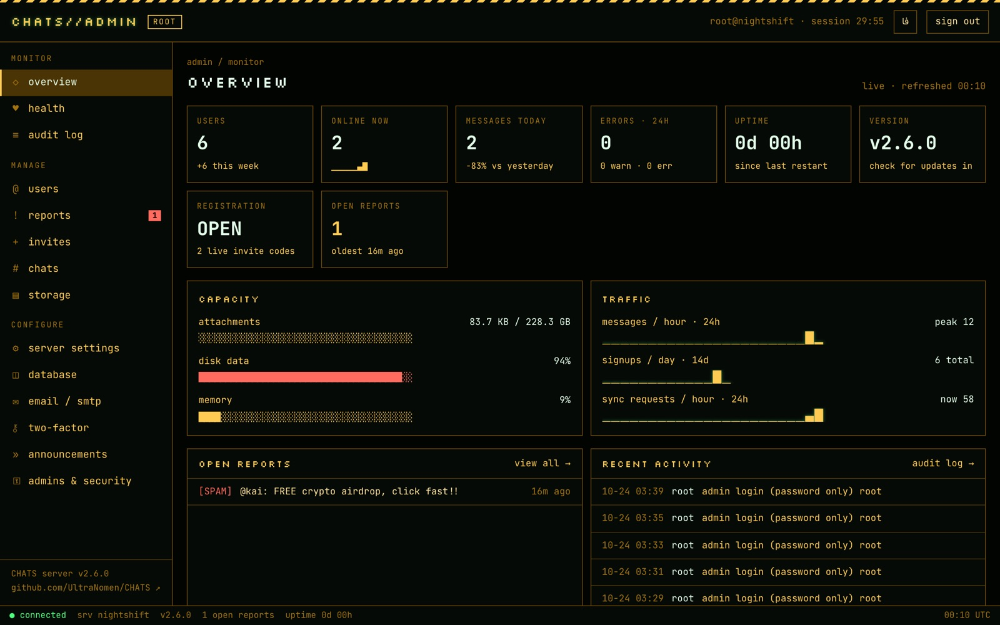
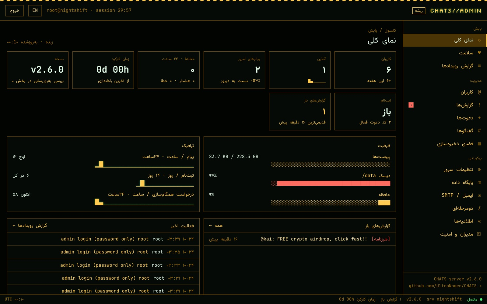

# CHATS: minimal self-hosted PHP chat with end-to-end encryption

[](https://github.com/UltraNomen/CHATS/releases)
[](https://github.com/UltraNomen/CHATS/actions/workflows/ci.yml)
[](LICENSE)
[](https://github.com/UltraNomen/CHATS/pkgs/container/chats)

**English** · [فارسی](README.fa.md)

**CHATS is a minimal, open-source PHP chat app with end-to-end encryption that you host yourself.** It's a private group chat for a team, a family or a community, as an alternative to Telegram, WhatsApp or Slack groups on someone else's servers. It runs on cheap **shared PHP hosting (cPanel)** or with one **Docker** command. People use it as an installable **web app (PWA)** on Android, iPhone and desktop, or as a **native app for Mac, Windows and Android**, and you manage the server from a built-in **admin console**. The interface is available in **English and Farsi (Persian), with full right-to-left support**.

The server only stores ciphertext. Messages, files, group names, contacts and passwords are encrypted on the device before they leave it.

It's small on purpose: a lightweight PHP backend with no framework and no Composer packages, and two web apps that each build into a single HTML file. A simple chat server you can read, audit and run anywhere.



## Features

### Private by design
- **End-to-end encryption** for messages, files, photos and group names (X25519, AES-256-GCM).
- **Passwords never leave the device.** Argon2id derives the keys, and the server only stores a hash.
- **8-word recovery phrase** to get back into an account without anyone holding your keys.
- **Two-factor sign-in** (TOTP, backup codes), an app lock with a PIN, and a list of signed-in devices.
- **Server key fingerprints:** the app warns you if a server you know suddenly looks different.

### A real messenger
- Direct and group chats, replies, edits, forwarding, @mentions and pinned messages.
- Photos and files of any type, with drag and drop and upload progress.
- Typing indicators, read receipts, online status and "last seen", each with privacy settings.
- Push notifications whose previews are encrypted too, plus offline mode and a share target.
- Installs like a native app from the browser, with no app store needed.
- [Native apps](native/README.md) for **Mac, Windows and Android** with notifications that don't depend on Google or Apple push servers.
- English and Farsi interface with right-to-left layout and the Vazirmatn font.

### Easy to host
- **PHP 8.1+ with no dependencies:** it runs on almost any shared hosting plan, such as cPanel or Plesk.
- **One-command Docker** image with automatic HTTPS (Caddy), and ready-made Docker Compose stacks.
- **SQLite, MySQL/MariaDB or PostgreSQL**, and switching between them later copies the data over for you.
- Files on local disk or any **S3-compatible** object storage.
- A first-run **setup wizard** in the browser; no command line needed.

### Admin console
- Users and roles, invite codes, an approval queue, reports and moderation, and announcements.
- Storage per user, backups, an audit log, server health, and maintenance mode.
- Optional two-factor for admins and an IP allow-list.
- Ships as **one HTML file**, so you can manage your server from anywhere, even a file on your laptop.

## Screenshots

| Phone | Farsi (right-to-left) |
|---|---|
|  |  |

| Admin console | Admin console in Farsi |
|---|---|
|  |  |

## Download

Every [release](https://github.com/UltraNomen/CHATS/releases) has these assets:

| asset | what it is | use it when |
|---|---|---|
| `chats-full-vX.zip` | chat app at `/`, console at `/admin/`, API at `/api/` | **most people.** Upload it to one web root and nobody has to type a server address |
| `chats-update-vX.zip` | the same files without the root `.htaccess` | upgrading an install whose `.htaccess` has your own lines |
| `chats-client-vX.zip` | the chat app alone | the app lives on a different host than the API |
| `chats-admin-vX.html` | the console as **one HTML file** | managing a server from anywhere |
| `chats-api-php-vX.zip` | the API alone, in an `api/` folder | API on its own host; the apps are hosted elsewhere |
| `ghcr.io/ultranomen/chats:X` | Docker image: Caddy (automatic HTTPS) + PHP + the full bundle | servers and VPSes |
| `chats-desktop-vX-mac.dmg`, `-windows-setup.exe`, `-windows.msi` | the [desktop app](native/README.md) for Mac and Windows | people who want CHATS in the menu bar or tray, with native notifications |
| `chats-android-vX.apk` | the [Android app](native/README.md) | Android phones, including notifications without Google |

`SHA256SUMS` lists checksums for every file.

## Quick start

**Shared hosting (cPanel, Plesk, any PHP 8.1+ host).** Upload `chats-full-vX.zip` to your web root or a subfolder and extract it, then open `/admin/`. [docs/deploy.md](docs/deploy.md#shared-hosting) covers PHP versions, keeping the data folder private and locking setup with a token.

**Docker, one container with SQLite:**

```bash
docker run -d --name chats -p 80:80 -p 443:443 -v chats-data:/data \
  -e CHATS_DOMAIN=chat.example.org -e CHATS_SETUP_TOKEN="$(openssl rand -hex 16)" \
  ghcr.io/ultranomen/chats:latest
```

Then open `https://chat.example.org/admin/?setup=<token>`.

**Docker Compose** with PostgreSQL, MySQL and/or S3 storage: see [deploy/compose](deploy/compose).

```bash
cd deploy/compose && cp .env.example .env    # set CHATS_SETUP_TOKEN, CHATS_DOMAIN, CHATS_DB_PASS
docker compose -f compose.postgres.yml up -d  # or compose.yml (SQLite), compose.mysql.yml; add -f compose.s3.yml for object storage
```

The setup wizard is pre-filled with the database and bucket from the environment. Their passwords stay on the server.

## FAQ

**Is CHATS really end-to-end encrypted?**
Yes. Keys are created and kept on your devices. The server stores only encrypted messages, encrypted files, wrapped keys and password hashes, so an admin with full database access can't read conversations. [SECURITY.md](SECURITY.md) lists exactly what the server can and can't see.

**Can I host it without Docker or a VPS?**
Yes. CHATS needs only PHP 8.1+ and a database driver; SQLite works out of the box. Upload one zip to normal shared hosting. It's tested on a LiteSpeed cPanel host, in a subfolder.

**Is there a mobile app?**
Yes, two kinds. On any phone, CHATS works as a Progressive Web App: open your server in Safari or Chrome and choose "Add to Home Screen". It then runs full-screen with its own icon, push notifications and offline start-up, with no app store involved. For Android there's also an [APK](native/README.md) whose notifications come from your own server instead of Google, and there are desktop apps for Mac and Windows.

**Which databases does it support?**
SQLite, MySQL/MariaDB and PostgreSQL. You can move a running server from one to another in the admin console.

**Does it support Farsi / Persian and right-to-left languages?**
Yes. Both the chat app and the admin console have a complete Farsi interface with right-to-left layout and the Vazirmatn font. Mixed English and Farsi text keeps the right direction.

**Does it work when only a national / domestic internet is available?**
Yes, if the server is hosted inside that network: chats, groups, files, encryption and the Farsi interface keep working. Push notifications need Google or Apple's servers, so they pause until international access returns; messages still arrive while the app is open. See [docs/deploy.md](docs/deploy.md#when-only-the-domestic-internet-works) for how to prepare.

**Is it free?**
Yes. It's open source under the AGPL-3.0: free to use, change and host. If you run a modified version for other people, you share your changes.

## Looking for…

CHATS fits if you searched for any of these:
- a **PHP chat** app or **PHP chat script** for your own hosting
- a **minimal chat** or **simple chat app** that is still secure
- a **self-hosted messenger** or **private group chat** for a team or family
- an **encrypted chat room** or **E2EE web chat** that runs in the browser
- a **lightweight chat server** with SQLite, MySQL or PostgreSQL
- an open-source **chat PWA** you can install on phones without an app store
- a **Persian / Farsi chat** app with right-to-left support

## Repository

```
client/        chat PWA (Preact): builds into one index.html + sw.js + manifest + icons
native/        Mac, Windows and Android apps (Tauri) around the chat app
admin/         admin console (Preact): builds into one self-contained HTML file
shared/        code both apps use: crypto, API client, i18n, design system, fonts
api/php/       the API (PHP 8.1+, no dependencies)
tests/         API conformance + security suites (Node), client tests
scripts/       build, release packaging, versioning
deploy/        Dockerfile, Caddyfile, compose variants
docs/          architecture, deployment, operations, testing, screenshots
```

## Development

Needs Node 20+ and PHP 8.1+ (or Docker).

```bash
npm ci
npm run build                                   # → dist/full, dist/client, dist/admin, dist/api-php
CHATS_DATA=/tmp/chats php -S localhost:8780 -t dist/full   # serve the full bundle
npm run dev                                     # chat app with hot reload, /api proxied to :8780
npm run dev:admin                               # same for the console
```

A **branded client** is locked to one server and skips the connect screen:

```bash
CHATS_SERVER=chat.example.org npm run build     # dist/client and dist/full use that server only
```

Tests are described in [docs/testing.md](docs/testing.md), and releases in [CONTRIBUTING.md](CONTRIBUTING.md#releases).

## Docs

- [Architecture](docs/architecture.md): diagrams of the parts, the encryption keys, sign-in, message sync, the data model and deployment layouts
- [Deployment](docs/deploy.md): shared hosting and cPanel, nginx, Docker and compose, split deployments, branded clients, domestic-only internet, updating
- [Operations](docs/operations.md): backups, switching database or storage, push, two-factor, versions
- [Native apps](native/README.md): Mac, Windows and Android downloads, notifications, building and signing
- [Testing](docs/testing.md)
- [Security](SECURITY.md): reporting vulnerabilities, the encryption model, hardening
- [Changelog](CHANGELOG.md)

## License

[AGPL-3.0](LICENSE). You can use, change and host CHATS freely. If you run a modified version for other people, you must offer them its source code.

The bundled Vazirmatn font is © The Vazirmatn Project Authors, under the [SIL Open Font License 1.1](client/public/fonts/Vazirmatn-OFL.txt).
