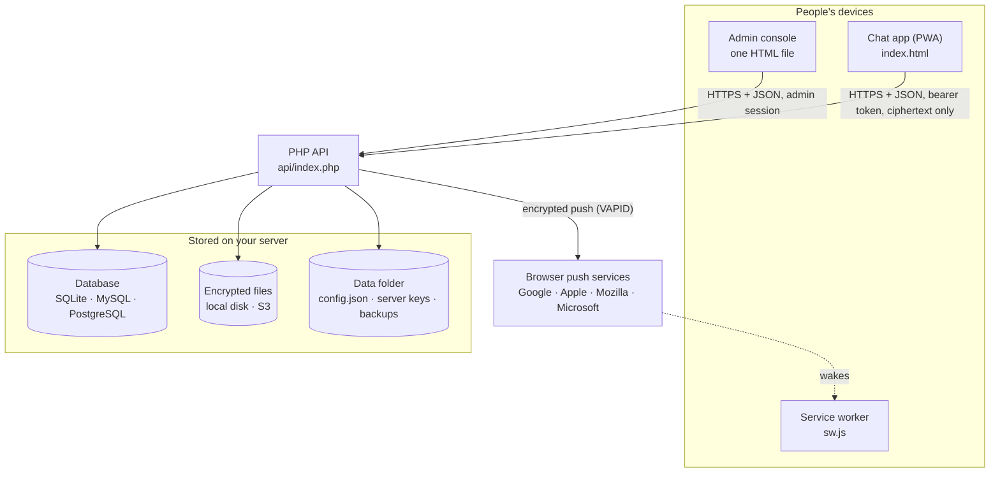
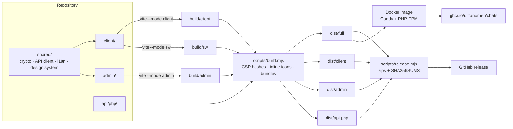
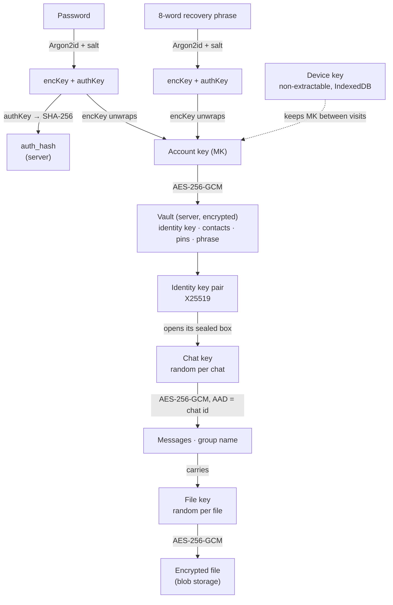
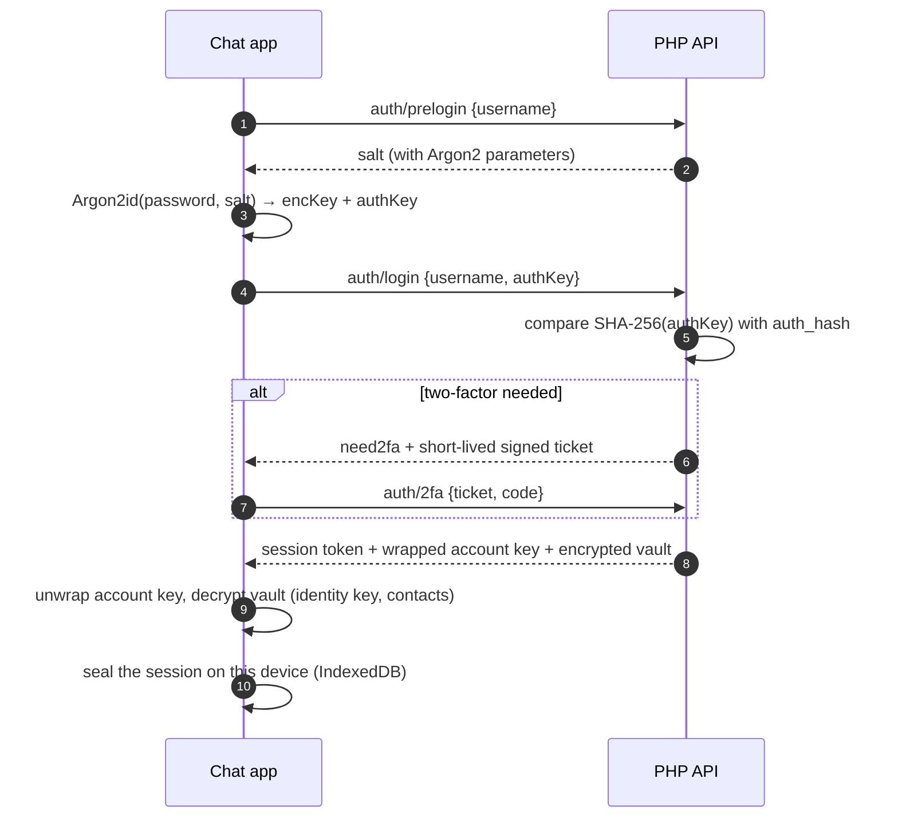
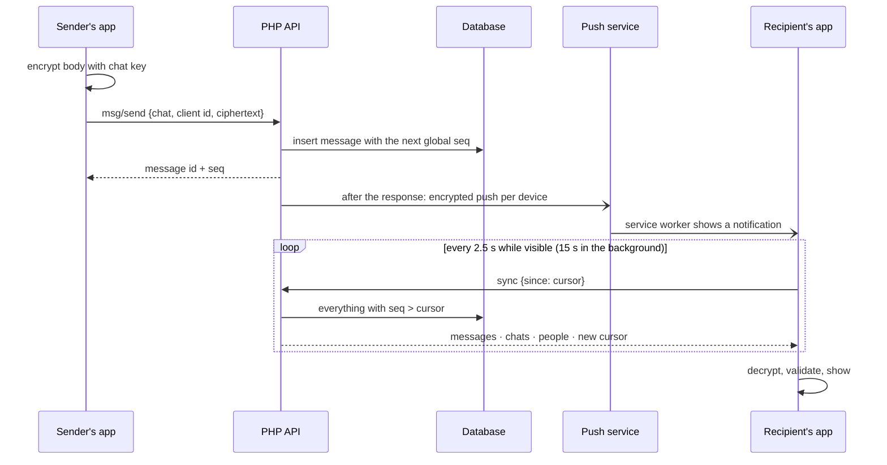
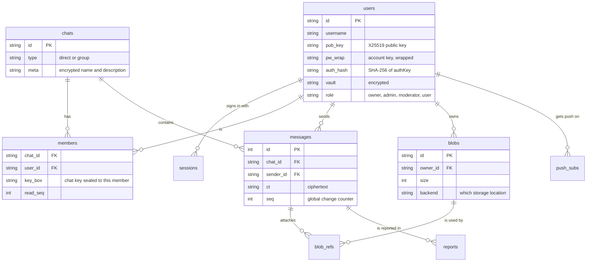
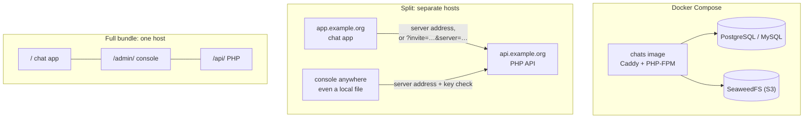

# Architecture

How CHATS is put together: the parts, how they talk, where the encryption happens, and how the code turns into releases. The diagrams are [Mermaid](https://mermaid.js.org), which GitHub draws in place.

- [System overview](#system-overview)
- [Repository and build](#repository-and-build)
- [Encryption and keys](#encryption-and-keys)
- [Signing in](#signing-in)
- [Sending and syncing a message](#sending-and-syncing-a-message)
- [Data model](#data-model)
- [Deployment layouts](#deployment-layouts)
- [Design decisions](#design-decisions)

## System overview

- **Chat app:** a Preact PWA that builds into one `index.html`, plus `sw.js`, the manifest, icons and the Farsi font. All encryption and decryption happens here.
- **Service worker:** caches the app for offline start-up, handles the share target, and decrypts push previews on the device.
- **Admin console:** a Preact app built into a single self-contained HTML file. It talks to the same API through `admin/*` routes, with separate, short-lived admin sessions.
- **PHP API:** one front controller (`api/index.php?r=route`) with plain PHP 8.1+ libraries and no framework. It stores what the apps send without being able to read it.
- **Push services:** only used to wake a device. The payload is encrypted for the device (RFC 8291), so those services can't read it either.

## Repository and build

- `shared/` is imported as `#shared/...` (the `imports` field in `package.json`), which works the same in Vite and in Node tests.
- `vite-plugin-singlefile` inlines all code, styles and most fonts. `scripts/build.mjs` then pins a Content-Security-Policy to the hash of each page's inline script.
- Pushing a `vX.Y.Z` tag runs [`release.yml`](../.github/workflows/release.yml): it builds every bundle, publishes the GitHub release and pushes the multi-architecture image. [`ci.yml`](../.github/workflows/ci.yml) runs the conformance and security suites against SQLite, MySQL and PostgreSQL on every push.

## Encryption and keys

- **Passwords never leave the device.** Argon2id produces two keys. `encKey` unwraps the account key, and the server keeps only a SHA-256 of `authKey` to check sign-ins. The Argon2 parameters are stored inside each salt, so accounts survive a change of defaults.
- **Recovery phrase:** a second, independent way to unwrap the same account key, with its own salt.
- **Chat keys** are random. Each member gets a copy sealed to their X25519 public key (ephemeral X25519 + HKDF-SHA256 + AES-256-GCM), stored as `members.key_box`.
- **Messages** are AES-256-GCM with the chat id as associated data, so ciphertext can't be moved between chats. After decrypting, the app validates every message as untrusted input (`shared/core/messages.js`).
- **Files** each get their own key, which travels inside the encrypted message. Only raster images keep their type after decryption; everything else becomes an opaque download.
- **Invite links** carry a token in the URL fragment, which never reaches the server; HKDF of the token unwraps the chat key.

## Signing in

Unknown usernames get a deterministic fake salt, so the response doesn't reveal which accounts exist. Admin sign-ins create separate `admin` sessions with a 30-minute idle timeout.

## Sending and syncing a message

- **One global counter:** every change (a message, an edit, a membership change, a profile update) gets the next `seq`, so a client asks for "everything since my cursor" and never misses or double-counts anything. Sync is plain HTTPS polling, which works on any PHP host, including shared hosting that can't hold connections open.
- **Duplicate sends are dropped:** the client id makes retries safe, so a message sent twice on a flaky connection is stored once.
- **Push is optional:** it runs after the response has been sent. When no push service is reachable (for example on domestic-only internet), the server pauses push for 10 minutes so sending stays fast.

## Data model

The schema is defined once in `api/php/lib/db.php` and created the same way on SQLite, MySQL and PostgreSQL. That's also what lets the console copy a running server from one database to another. Smaller tables include `invites`, `announcements`, `audit`, `typing`, `stats`, `logs`, `attempts` (rate limits) and `kv`.

## Deployment layouts

- **Full bundle:** both apps find the API next to them, so nobody types a server address.
- **Split:** the chat app asks for the server once. The server's *chat app address* setting makes invite links open the app and name the server. Branded builds (`CHATS_SERVER=…`) skip the question entirely.
- **Docker:** Caddy gets HTTPS certificates automatically, and `CHATS_DB_*` / `CHATS_S3_*` variables pre-fill the setup wizard without sending secrets to the browser.

## Design decisions

| decision | why |
|---|---|
| Plain PHP 8.1+, no framework or Composer | runs on cheap shared hosting and is small enough to audit |
| Polling with a global `seq` cursor | works everywhere PHP runs; no long-lived connections needed |
| All crypto in the browser (WebCrypto, Argon2 in WebAssembly) | the server stays a store of ciphertext it can't read |
| Each app builds into one HTML file | easy to host anywhere, to verify, and to keep offline |
| A protocol number in `/info` | apps refuse servers that need a newer app, instead of failing in strange ways |
| One version for API and apps | a release is one tag, one changelog entry, one set of assets |
| Fonts and assets bundled, nothing from third-party CDNs | works on domestic-only internet and keeps the CSP strict |

More: [deployment](deploy.md) · [operations](operations.md) · [security model](../SECURITY.md) · [testing](testing.md)
